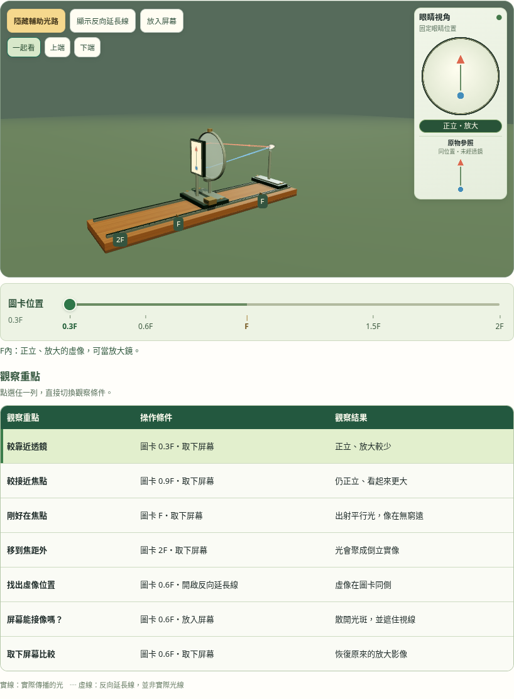
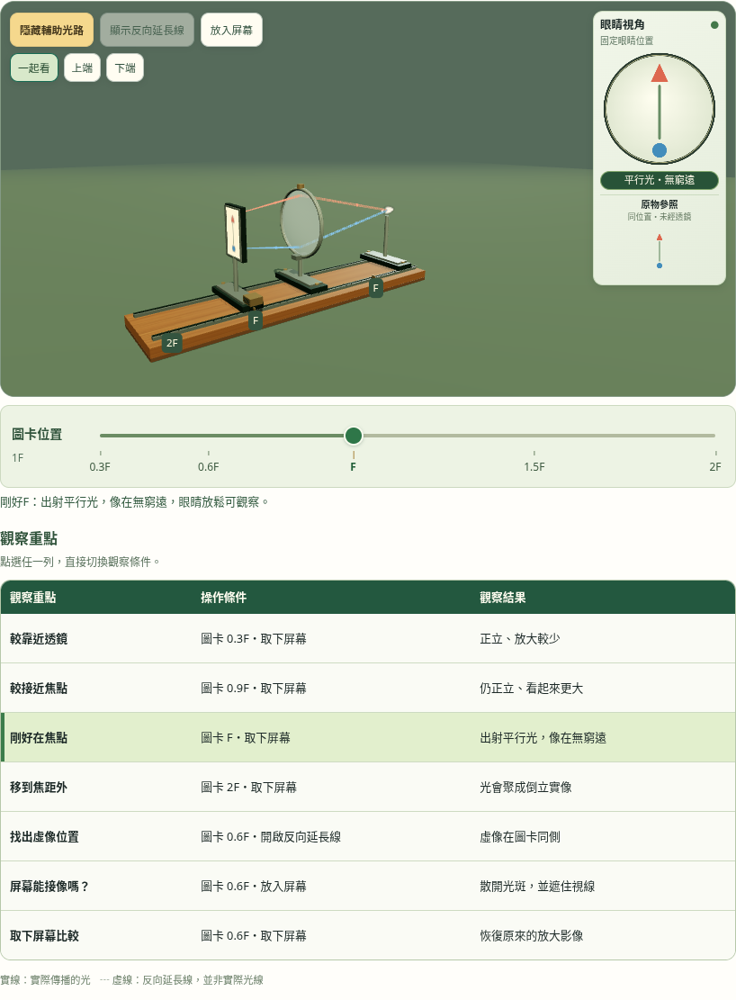
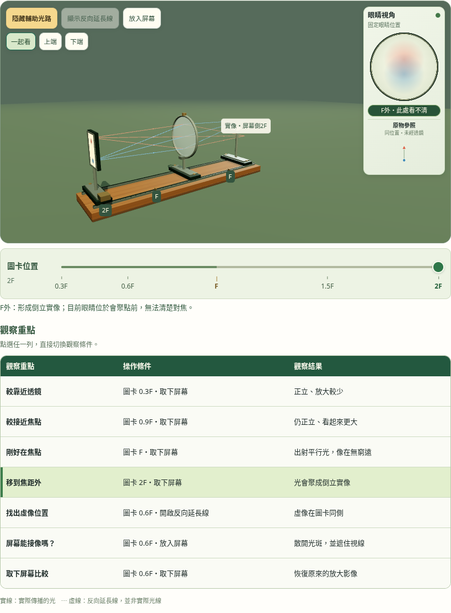
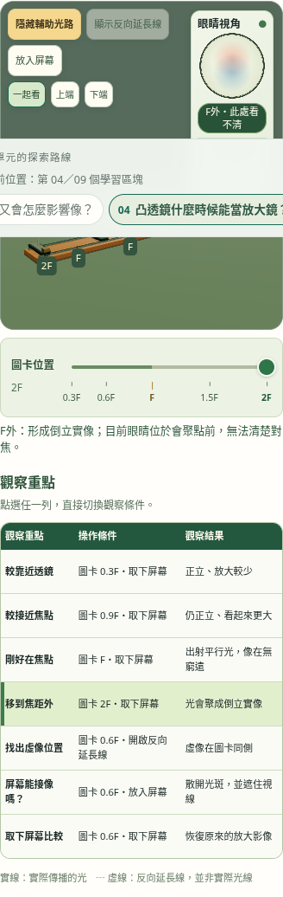

# 4.4 第四區跨越F與預設光路

2026-11-03依使用者回饋，圖卡範圍擴為0.3F至2F，F可點選、跨越；載入即開啟輔助光路。第三區的F外／F內比較在第四區繼續實際操作，觀察表增加F與F外兩列，共七列。

## 驗證

```sh
node tests/unit-4.4-magnifier-optics.test.mjs
MAGNIFIER_CAPTURE_DIR=/tmp/magnifier-cross-f-verified node tests/unit-4.4-magnifier-studio.test.cjs
LENS_CAPTURE_DIR=/tmp/magnifier-cross-f-integration node tests/unit-4.4.test.cjs
```

模型5項、立體12項、整課23項，共40項通過（瀏覽器含主項）。[立體測試](studio-tests.txt)、[整頁回歸](integration-tests.txt)。

- 模型驗F前後0.001F、F平行出射的有限角度極限、F外正向會聚位置、座標皆有限、原眼睛與參照尺度保持。
- 實際位置尺／刻度／鍵盤可跨過F；返回F內恢復相同眼睛像素。原生觸控可移至F外，七列保留光路開關偏好。
- F內保持原虛像；F上像在無窮遠，放鬆的眼睛仍可觀察；F外實像在固定眼睛之後，因此右欄不冒充清晰虛像。光斑僅示意無法清楚對焦，不是眼睛調節或視網膜模擬。
- 極近F的遠像保留「視野外」與真實距離標籤，不裁改模型，亦不把相機拉到近無窮遠。
- 七寬度×F內／延長線／F／F外共28組，檢查右欄、同尺度原物參照、器材範圍、標籤與頁面不溢出。說明放於尺下，眼睛及參照的CSS畫面尺度不隨條件改變。
- 保留屏幕遮擋／取下恢復、相機旋轉／五倍近看、器材抓取偏移、觸控取消／雙指縮放及WebGL備援。測試觀察介面只由攔截模組注入。

Chromium軟體WebGL及CDP觸控模擬；未作Safari實機驗證。公開驗證使用獨立輸出目錄，不覆寫本機紀錄。

## 畫面





