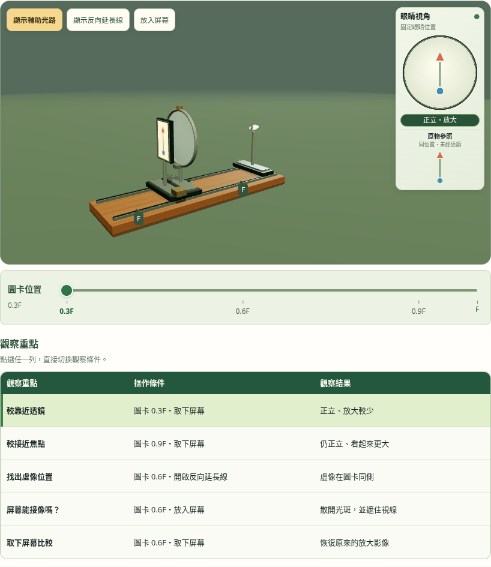
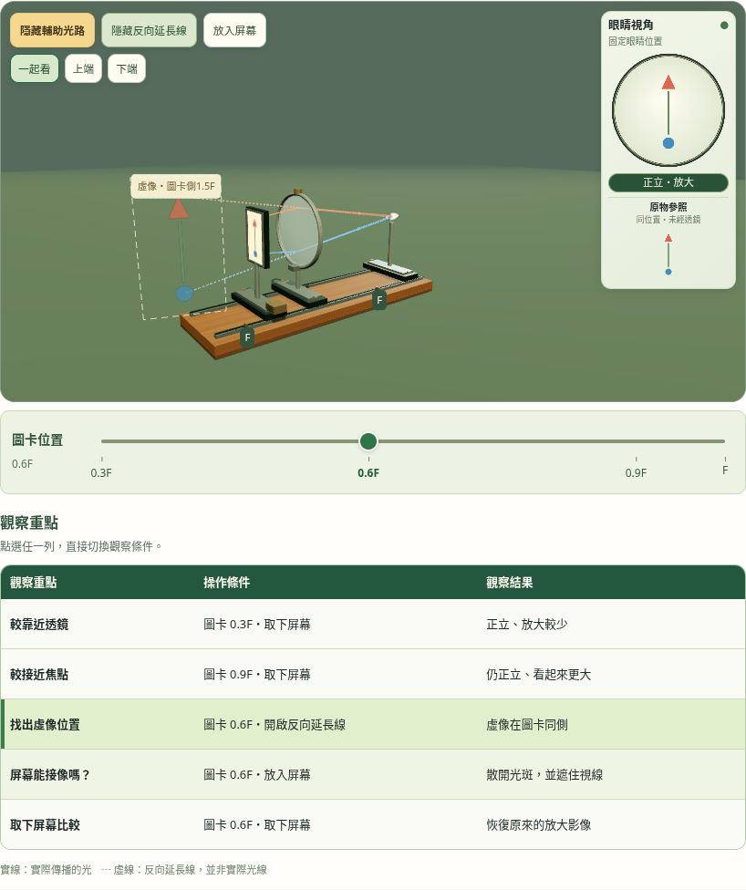
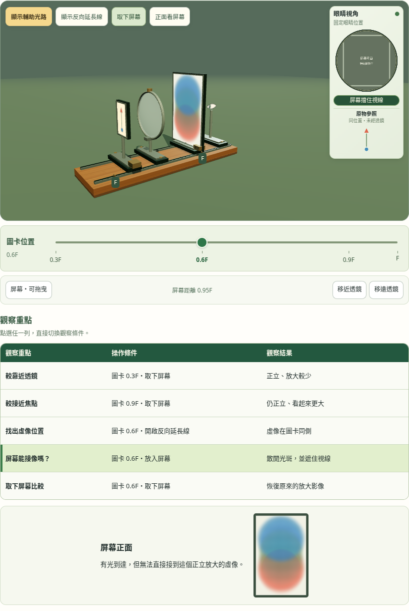
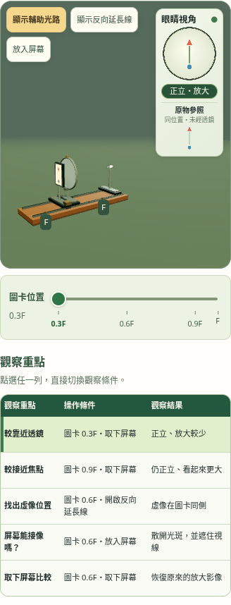

# 4.4 第四區：位置尺與觀察表格

2026-11-03。依使用者核可示意製作，光學與固定眼睛畫面沿用原模型。正式頁沒有測試全域API。

- 下方一把圖卡F尺，五列觀察表可整列點選、鍵盤啟動；第一欄無按鈕框。手動操作同步狀態，未符合任何預設時不標選。
- 比較0.3F、0.9F的眼睛影像；0.6F可看真正的虛像交點與透明圖案，或插入／取下屏幕比較。位置、倍率與延長線由同一模型計算。
- 右側固定眼睛／同尺度原物參照保留；屏幕顯示散開光斑並遮住視線，取下恢復同物距的相同像素。
- 去除重複標題、條件徽章、旋轉提醒及說明卡，主圖預留右欄與工具區，支援五倍近看。

## 本機驗證

```sh
node tests/unit-4.4-magnifier-optics.test.mjs
MAGNIFIER_CAPTURE_DIR=/tmp/magnifier-observations-final node tests/unit-4.4-magnifier-studio.test.cjs
LENS_CAPTURE_DIR=/tmp/unit44-magnifier-integration node tests/unit-4.4.test.cjs
```

4項模型、11項立體專項、23項整頁回歸，共38項通過（瀏覽器數量含主項）。[立體測試](studio-tests.txt)、[整頁測試](integration-tests.txt)。

實際像素核對正立及連續大小、眼睛／參照同尺度；相機及光路不改眼睛像素。另驗整列／鍵盤／位置尺連動、不自動捲動、虛像真座標、三條反向線同點、屏幕比較、五倍相機距離、直接拖曳、七寬度、CDP原生觸控與WebGL備援。Chromium軟體WebGL與觸控模擬，不代表Safari實機測試。

## 畫面






公開檢查沿用MAGNIFIER_URL與獨立輸出資料夾，部署完成後以公開頁面及資源版本核對。
