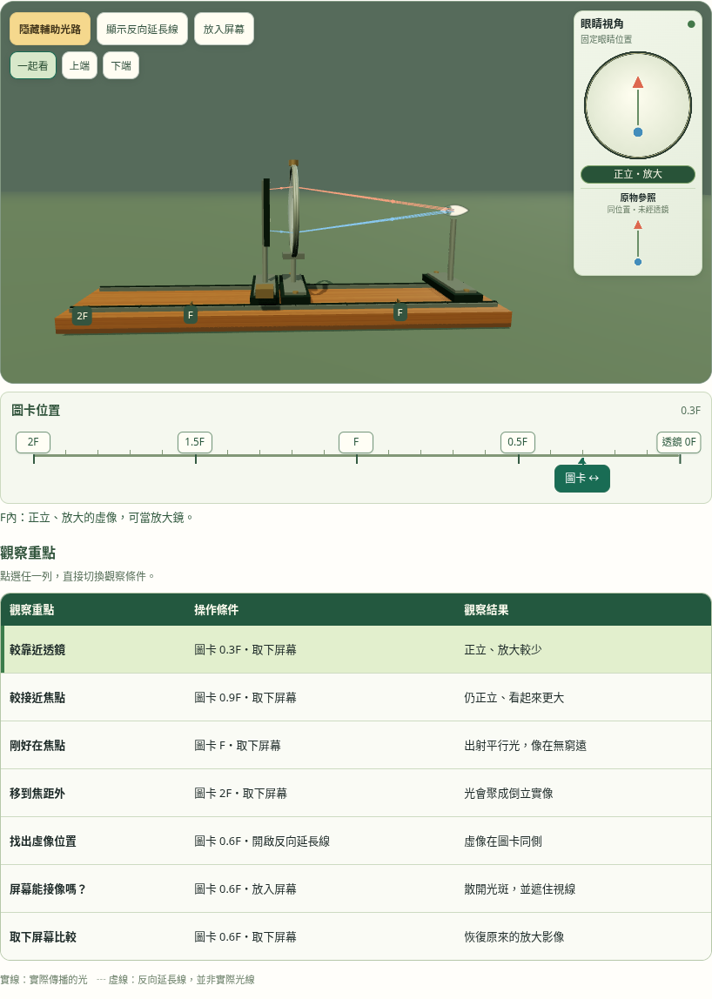
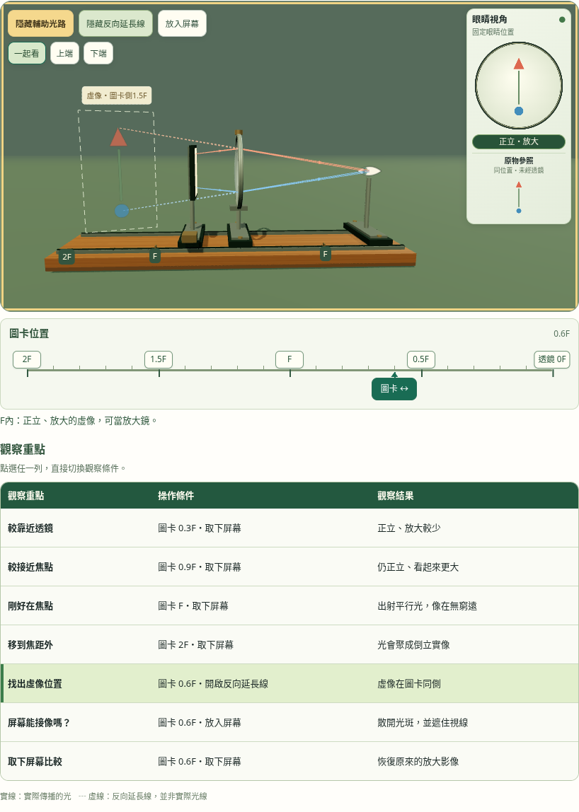

# 第四區：大取景、同向刻度與一致比例

2026-11-04依三項回饋合併實作。預設接近水平側視，木軌佔可用3D寬度82.8%；各觀察列與初始相同的相機距離及FOV。圖卡尺以第三區的方向呈現，左2F、右透鏡0F，刻度按鈕與綠色把手取代原生拉桿。

```sh
MAGNIFIER_CAPTURE_DIR=/tmp/magnifier-ruler-view node tests/unit-4.4-magnifier-studio.test.cjs
LENS_CAPTURE_DIR=/tmp/magnifier-ruler-view-integration node tests/unit-4.4.test.cjs
```

12項第四區專項及23項整頁回歸，共35項通過（含主項）。[第四區](studio-tests.txt)、[整頁](integration-tests.txt)、[初始比例](initial-framing.json)。本輪沒有修改光學模型，其他套件結果為歷史紀錄。

- 七寬度×六種觀察條件42組：相機距離一致、右欄及標籤在舞台內，虛像圖案不被標籤遮擋。
- 實際鼠標與原生觸控向右拖把手，物距下降、圖卡世界座標向右；鏡片與相機保持。鍵盤方向、刻度及Home／End也可跨F。
- 原有眼睛／參照同尺度像素、屏幕遮擋／取下恢復、五倍近看、旋轉、觸控取消與WebGL備援保留。

Chromium軟體WebGL及CDP觸控，未作Safari實機驗證；公開驗證另存獨立輸出。



